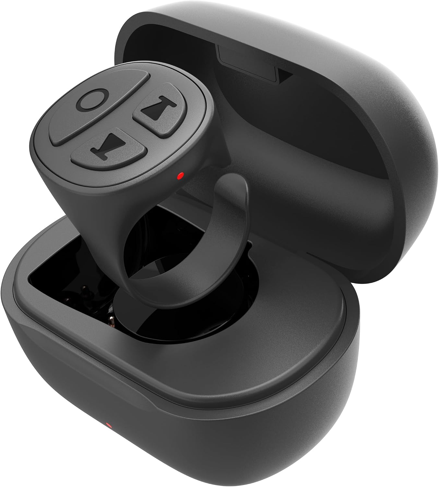
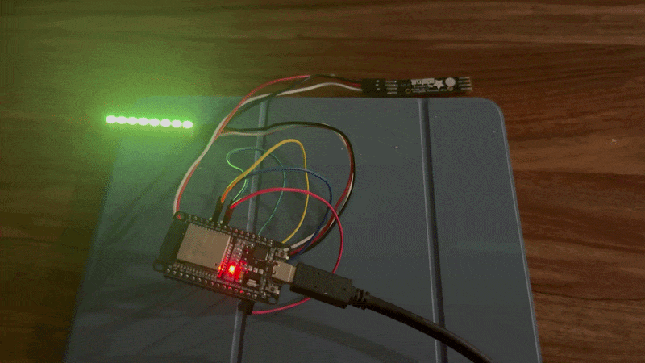

# ESPHome Classic HID Host

A lightweight ESPHome external component for exposing a Classic Bluetooth HID host on the ESP32 and surfacing raw HID input events for custom control logic.

I bought one of these Bluetooth “TikTok” rings on Amazon and repurposed it as a controller for my Buggy Blinker project.

<p align="center">
  
</p>

<p align="center">
  
</p>

<div align="center">
  <a href="https://github.com/deisterhold/BLE_HID_Host"></a>
  <a href="https://www.amazon.com/dp/B0G6YSP7MM"></a>
</div>

## Overview

This component owns the ESP32 Bluetooth controller and forwards raw HID input reports without trying to interpret device-specific button semantics. That keeps it generic, reusable, and easy to integrate into ESPHome automations.

When `on_input` fires, the callback receives:

- the Bluetooth device address
- the protocol mode (`0` = boot, `1` = report)
- a raw `std::vector<uint8_t>` containing the HID input payload

This makes it easy to filter in ESPHome lambdas by address, report ID, payload bytes, or exact button bit patterns.

## Why this exists

The goal is simple: connect a Classic Bluetooth HID device to an ESP32 running ESPHome, then react to the underlying HID report stream in YAML without writing custom firmware for every device.

The included example uses a Bluetooth ring and turns button presses into LED effects on two SK6812 RGBW strips.

## Example project

The included `classic_bt_hid_example.yaml` configures two SK6812 RGBW strips and demonstrates the observed ring-button release filters:

- report ID `0x03`
- button bits `0x10`, `0x20`, and `0x04`

Those filter values are example-specific. The component itself does not interpret them; it simply emits the exact raw bytes received from the device.

## Hardware

This project is built around this Bluetooth ring by Vekesen:

- Amazon link: https://www.amazon.com/dp/B0G6YSP7MM

## Quick start

Add the component to your ESPHome configuration:

```yaml
external_components:
  - source: github://deisterhold/esphome-components
    components: [classic_bt_hid]
```

Then configure an original ESP32 with the ESP-IDF framework and enable the Classic Bluetooth HID Host options shown in `classic_bt_hid_example.yaml`.

Note: newer ESP32 variants such as the S2 and S3 do not support the Classic Bluetooth HID host path in the same way, so this project is intended for the classic ESP32 (original Bluedroid-based controller).

The `mac_address` option is optional. If omitted, the component scans for the first discovered Bluetooth peripheral and reconnects after disconnects or connection failures.

## Example behavior

The sample config defines two NeoPixel strips on GPIO 18 and GPIO 21, and it uses button transitions to trigger yellow blinking effects and turn-signal-style behavior.

## Important constraints

- This component must be the only owner of the ESP32 Bluetooth controller.
- Do not combine it with ESPHome BLE tracker, BLE client, BLE server, or Bluetooth proxy components.
- Pairing confirmation is accepted automatically.
- Legacy PIN requests are answered with `0000`.

## Repository layout

```text
.
├── README.md
├── classic_bt_hid_example.yaml
├── components/
│   └── classic_bt_hid/
│       ├── __init__.py
│       ├── classic_bt_hid.cpp
│       └── classic_bt_hid.h
├── images/
│   ├── buggy-blinker.gif
│   └── ring.jpg
└── .gitignore
```

## Validation status

ESPHome CLI was not installed in this workspace, so the component and example YAML were not compiled here with `esphome compile`. The existing native ESP-IDF firmware remains unchanged.

## License

This project is released under the MIT License. See the repository license file for details.
